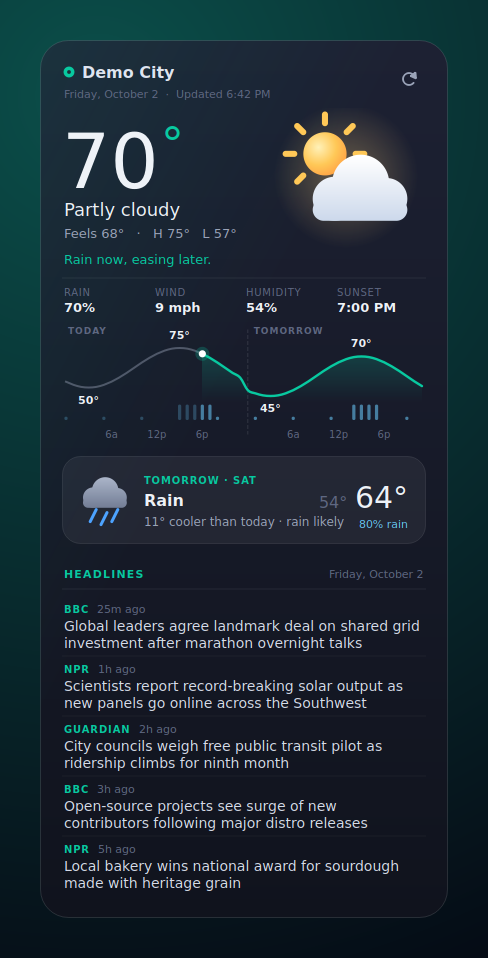

# CachyOS Weather Widget

A small desktop card for CachyOS: **today's weather, tomorrow's weather, and the day's headlines**.
Python + PyQt6, no API keys, no web view, no image assets (icons are painted as vectors).


<sub>Preview rendered from `--demo` sample data over a stand-in wallpaper.</sub>

## What you get

- **Today**: current temp, condition, feels-like, high/low, rain %, wind, humidity, sunset/sunrise, and one plain-English line ("Rain likely around 3 PM.").
- **48-hour curve**: today + tomorrow on one temperature line with rain bars and a "now" marker.
- **Tomorrow**: condition, high/low, rain chance, and how it compares with today ("6° cooler than today").
- **Headlines**: 5 stories merged round-robin from BBC, NPR and The Guardian; click one to open it.
- Data: [Open-Meteo](https://open-meteo.com) (weather + city search; free, no key) and public RSS feeds. Location is auto-detected from your IP the first time unless you set one.
- Works offline from cache (shows the last forecast and retries every ~90 s).

## Run it

```bash
sudo pacman -S --needed python-pyqt6   # the only dependency
./run.sh --demo                        # try it with sample data, no network
./run.sh                               # live
```

Install for your user (launcher + app-menu entry; add `--autostart` to start at login):

```bash
./install.sh --autostart      # remove with ./install.sh --uninstall
```

## Using it

- **Drag** anywhere on the card to move it. **Right-click** for: refresh, change location, °F/°C, stay-on-desktop, edit settings, quit.
- Click the **city name** to change location, click **↻** to refresh.
- Settings live in `~/.config/cachy-widget/config.json` (right-click → *Edit settings & news feeds…*): `location`, `units`, `news_count`, `feeds` (any RSS/Atom URLs), refresh intervals, `opacity`.

## Making it sit on the desktop

Wayland compositors decide window stacking, so an app can't pin itself to the desktop layer; you add a rule once.

- **KDE Plasma** (CachyOS default): `scripts/kde-desktop-rule.sh` (optionally `scripts/kde-desktop-rule.sh 1500 80` to pin the starting position). It adds a KWin rule matching app id `cachy-widget`.
  Or by hand: *System Settings → Window Management → Window Rules*, match window class `cachy-widget`, force *Keep below*, *Skip taskbar/pager/switcher*.
- **Hyprland / Sway / others**: match the app id `cachy-widget` in a floating/pinned/no-focus window rule and position it where you want.
- **X11 sessions**: nothing to do; the "stay on desktop" option is honoured directly.

Background blur isn't something a Qt app can request on its own; the card uses a ~94% opaque dark fill that looks right without it. Lower `opacity` in the config, and add a blur rule for `cachy-widget` in KWin/Hyprland if you want frosted glass.

## Design notes

Palette follows the CachyOS Plasma colour scheme (deep navy `#181B28`-family surfaces, cyan `#66C2F2` for rain/cool data) with a teal-green accent (`#08C9A0`) standing in for the brand green. Today is the hero, tomorrow is a smaller card, headlines are source + age + at most two lines with hairline dividers and no thumbnails. All colours are in `cachy_widget/theme.py`.

## Develop

```bash
python3 -m pytest tests                                           # parsing + summary logic
QT_QPA_PLATFORM=offscreen ./run.sh --demo --screenshot out.png    # headless render
```

## Status / honesty notes

Built and tested in a headless Linux container: unit tests pass and the UI renders correctly offscreen, but that environment had no access to the weather/news hosts and no real KDE/Wayland session. So the live fetch path, window dragging, the stay-below behaviour and `scripts/kde-desktop-rule.sh` have **not** been exercised on a real CachyOS desktop. If something is off, `./run.sh` prints errors to the terminal.
